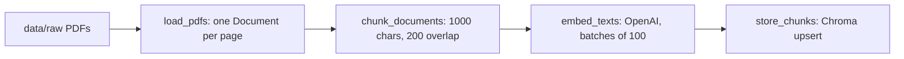
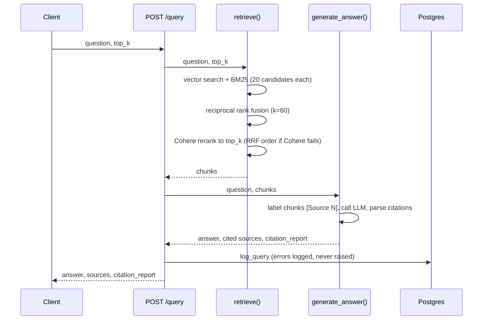
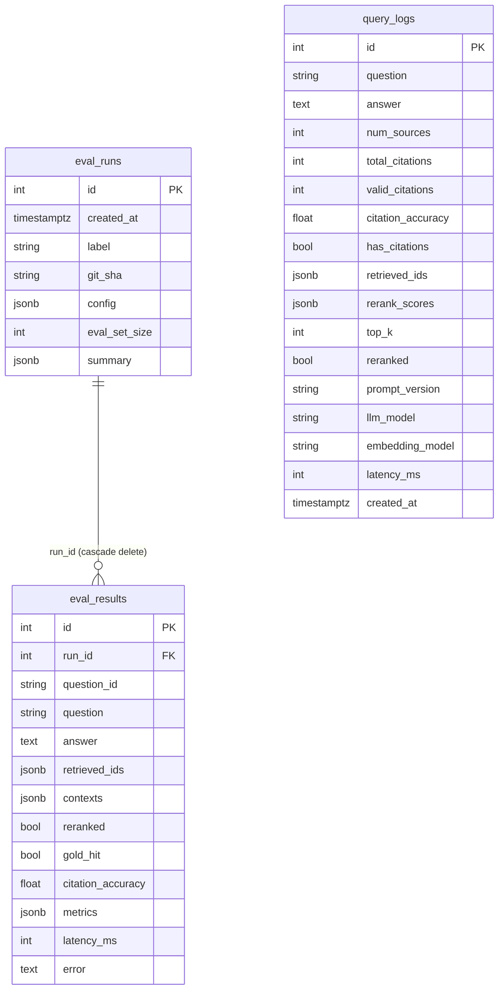

# Architecture

Stable design reference. Read before changing the pipeline, schema or routes.
Status and progress live in `ROADMAP.md`. Files and functions are named, not linked.

## What it is
A FastAPI service that answers questions about exercise science and public health guidelines from two ingested PDFs (WHO guidelines and the US Physical Activity Guidelines, 2nd ed.). Every answer cites its sources as `[Source N]`, and every answered query is logged with citation quality metrics and a retrieval trace.

## System overview
| Component | Technology | Where it lives |
|---|---|---|
| API | FastAPI, plain `def` handlers (blocking pipeline runs in the thread pool) | `app/main.py` |
| Vector store | ChromaDB, embedded, cosine, 843 chunks | `./chroma_db` (not in git) |
| Keyword index | BM25 (rank-bm25), built in memory from Chroma | `app/retriever.py` |
| Embeddings | OpenAI `text-embedding-3-small` | `app/ingest.py` |
| Reranker | Cohere `rerank-v3.5` | `app/retriever.py` |
| LLM | OpenAI `gpt-4o-mini`, temperature 0 | `app/generator.py` |
| Database | PostgreSQL 17 + SQLAlchemy 2.0 + Alembic | `app/db.py`, `alembic/` |
| Config | pydantic-settings, from `.env` | `app/config.py` |
| Prompt | versioned YAML (system + template) | `prompts/rag_prompt.yaml` |

## Codemap
- `app/config.py` — the one `settings` object; every other module imports it.
- `app/ingest.py` — `load_pdfs` → `chunk_documents` → `embed_texts` → `store_chunks`; `ingest()` runs all four. Also creates the shared OpenAI and Chroma clients.
- `app/retriever.py` — `vector_search`, `bm25_search`, `reciprocal_rank_fusion`, `rerank`; `retrieve()` runs them in order.
- `app/generator.py` — `build_context`, `generate_answer`, `validate_citation`, `extract_cited_sources`, `load_prompt`.
- `app/db.py` — models `QueryLog`, `EvalRun`, `EvalResult`; `log_query`; the `/history` readers `citation_stats`, `recent_queries`, `fabricated_queries`.
- `app/main.py` — routes `/health`, `/query`, `/ingest`, `/history`, plus the request and response models.
- `alembic/` — `env.py` takes the database URL from settings and the models' metadata as its target; `versions/` holds migrations.
- `eval/` — `eval_set.json` (questions with page-level gold labels), `dataset.py` (load + validate), `metrics.py` (hit@k, MRR, page recall, cited-gold, refusal, summary, threshold check), `run_eval.py` (CLI runner), `find_pages.py` (phrase → indexed page lookup), `thresholds.json`.

## Data flow: ingestion

- Chunk id is `<file>::p<page>::c<index>`. It is deterministic, so re-ingesting overwrites rather than duplicates.
- Pages with no extractable text are skipped; pages are 1-indexed.

## Data flow: a query

- The answer's `[Source N]` numbers index into the chunks the model was shown, in order.
- `citation_report` checks that each N is in range. It does **not** check that the source supports the claim.
- Failures: Chroma collection missing → 503; OpenAI error → 502; database logging error → ignored.

## Data flow: an eval run
`run_eval.py` validates the set against the pages in Chroma, opens an `eval_runs` row (label, git sha, full config), then per question calls `retrieve()` and `generate_answer()` directly (never `/query`). Custom metrics compare retrieved and cited `(source, page)` pairs with the gold pages; RAGAS (`gpt-4o-mini` judge) scores faithfulness, answer relevancy, context precision and context recall on answered, answerable questions. One `eval_results` row per question, the summary on `eval_runs`, then exit 1 if a threshold in `thresholds.json` is missed, a question errored, or Cohere fell back to RRF order (run not comparable). Rerank calls are spaced by `eval_rerank_delay_s` for trial Cohere keys.

## Data flow: `GET /history`
`citation_stats` is one aggregate query (`FILTER (WHERE ...)`), plus `recent_queries` and `fabricated_queries`. Optional `?days` (1–365) and `?limit` (1–100, default 10). A database error returns 503, because there is no useful partial answer.

## Database

- `query_logs` is production traffic. `eval_*` is evaluation only. They never mix, so `/history` reflects real use.
- Alembic is the only way the schema changes. Head: `a9d742709640`.
- `fabricated_citations` is not stored; it is `total_citations - valid_citations`.

## Boundaries
- **Routes ↔ logic:** `main.py` validates, calls, and maps errors to HTTP. SQL lives in `db.py`; retrieval and generation logic in `retriever.py` and `generator.py`.
- **Application ↔ external services:** OpenAI and Cohere are called only from `ingest.py`, `retriever.py` and `generator.py`.
- **Application ↔ database:** only `db.py` touches SQLAlchemy sessions.

## Invariants (what must never happen)
- `db.py` never imports from `main.py`, `retriever.py` or `generator.py`.
- A database failure never fails `/query` or loses a paid-for answer.
- The eval runner never calls `/query`; it uses `retrieve()` and `generate_answer()` directly.
- Prompts are never hardcoded in Python.
- Secrets are never in git; `.env` is gitignored.
- No `Base.metadata.create_all` against Postgres.

## Cross-cutting concerns
- **Configuration:** `settings` only; models, paths and thresholds all come from `.env` or defaults.
- **Errors:** Cohere failure degrades to RRF order, logged as a warning, flagged by `reranked=false`.
- **Observability:** every query stores ids, rerank scores, prompt version, models and latency.
- **Reproducibility:** `temperature=0` reduces but doesn't remove variation. Average several eval runs.
- **Caching:** BM25 index (keyed on chunk count) and `load_prompt()` are cached; restart after changing either.

## Key decisions
| Decision | Why |
|---|---|
| Fuse by rank (RRF), not by score | BM25 scores and cosine distances aren't comparable |
| Rerank after fusion with Cohere | Cross-encoder reads query and chunk together; scores separate on-topic (~0.9) from off-topic (~0.03) |
| Store fabricated count as total − valid | Derivable; avoids a column that can disagree |
| Separate eval tables | Eval traffic would skew `/history` |
| `JsonType` (JSONB on Postgres, JSON on SQLite) | Offline tests run on SQLite |
| Gold labels at page level, not chunk id | Chunk ids change when chunking settings change |
| Pin `langchain-community<0.4` | ragas imports a module removed in 0.4 |
| Fail an eval run that used the RRF fallback | Cohere rate limits would otherwise silently lower scores |

## Not built yet
Thresholds (set after the baseline), authentication on `/history` and `/ingest`, Docker, CI, Celery + Redis, Streamlit. See `ROADMAP.md`.
